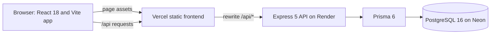
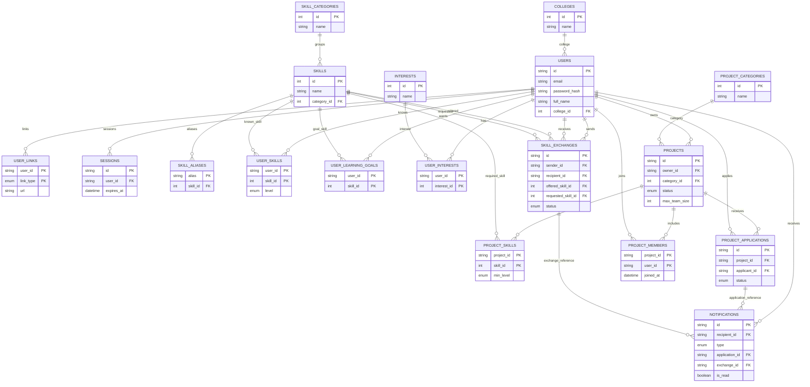

# SkillBridge

Students can have a hard time finding project teammates with the skills they need, or peers who can teach them something new. SkillBridge brings student profiles, project discovery, team applications, explainable teammate matching, and peer skill exchanges into one collaboration platform. It is a two-student capstone for Advanced Programming and Data Engineering.

**Live app:** [skillbridge-seven-tau.vercel.app](https://skillbridge-seven-tau.vercel.app)

**API health:** [skillbridge-6dhg.onrender.com/api/health](https://skillbridge-6dhg.onrender.com/api/health)

## Features

- Student accounts with server-side sessions and editable profiles, skills, learning goals, interests, and links.
- Searchable skill catalogue with categories and aliases.
- Project creation, editing, discovery filters, and project status changes.
- Applications and team formation. Accepting an application locks the project row while checking capacity, so simultaneous accepts cannot take the same last seat.
- Peer skill exchanges with participant-specific actions and state transitions.
- Ranked teammate suggestions with a score breakdown and plain-language reasons.
- In-app notifications, unread counts, and read actions.
- Dashboard shortcuts and recent notifications.

## Technology

Versions below are the package manifest ranges; Node and PostgreSQL versions are taken from the engine/CI configuration.

| Area | Packages and versions |
|---|---|
| Runtime and database | Node.js `>=22` (CI uses 22); PostgreSQL 16 |
| Server | Express `^5.3.0`, Prisma and `@prisma/client` `^6.19.3`, Zod `^4.6.7` |
| Server security and logging | bcryptjs `^3.0.3`, helmet `^8.3.0`, cors `^2.8.6`, cookie-parser `^1.4.7`, express-rate-limit `^8.7.1`, pino `^10.4.0`, pino-http `^11.0.0`, dotenv `^18.0.9` |
| Client | React and React DOM `^18.3.1`, Vite `^8.3.4`, React Router DOM `^6.30.6`, TanStack Query `^5.104.5`, axios `^1.20.0`, react-hook-form `^7.91.0`, `@hookform/resolvers` `^5.9.2`, Zod `^4.6.7`, Tailwind CSS and `@tailwindcss/vite` `^4.3.3` |
| Quality | Vitest `^5.0.5`, Supertest `^7.3.1`, Testing Library `^16.3.3`, oxlint `^1.88.0`, ESLint `^9`, GitHub Actions |

## Architecture

The browser runs a React single-page app. Vercel serves the client and rewrites `/api/*` requests to the Express API on Render. The API validates requests, runs authorization and business rules in feature services, and uses Prisma to access PostgreSQL on Neon. The API is a modular monolith; the browser never accesses the database directly.



The database has 18 tables. This diagram shows the main columns and foreign-key relationships; `id` is the primary key unless a composite key is shown.



### Normalization

Independent many-to-many facts are kept in junction tables such as `user_skills`, `user_interests`, and `project_skills`, rather than repeated in profile or project rows. This is the schema's 5NF-oriented decomposition: each table records one kind of fact and keys constrain duplicate relationships. Derived values are computed when needed: team size and seats, match scores, unread counts, and notification message/link text are not stored as snapshots.

## Run locally

Requirements: Node.js 22 and PostgreSQL 16, with `skillbridge_dev` and `skillbridge_test` databases available.

```sh
git clone https://github.com/amangupta874/skillbridge.git
cd skillbridge
npm ci
cp server/.env.example server/.env
cp server/.env.test.example server/.env.test
```

Set `DATABASE_URL` in `server/.env` to the development database and in `server/.env.test` to the separate test database. Keep both files private. Then run:

```sh
cd server
npx prisma generate
npx prisma migrate dev
npm run db:seed
cd ..
npm run dev
```

The client runs at `http://localhost:5173` and the API at `http://localhost:4000`. In another terminal, run the project quality gate:

```sh
npm run verify
```

`verify` runs lint, server and client tests, and the client production build.

## Environment variables

The API reads `server/.env` for development and `server/.env.test` during tests. The client can use `client/.env` only when the API is on a different origin; the recommended local proxy and deployed Vercel rewrite leave `VITE_API_URL` empty.

| Variable | Purpose |
|---|---|
| `NODE_ENV` | `development`, `test`, or `production`; defaults to `development`. |
| `PORT` | API listen port; defaults to `4000` locally. The host supplies it in production. |
| `DATABASE_URL` | PostgreSQL connection string; required. Use a separate test database. |
| `CLIENT_ORIGIN` | Exact frontend origin allowed by CORS and the state-changing request origin check; required. |
| `SESSION_DAYS` | Session lifetime in days; defaults to `7`. |
| `COOKIE_SAMESITE` | Session cookie policy (`lax`, `strict`, or `none`); defaults to `lax`. |
| `LOG_LEVEL` | Pino log level; defaults to `info`. |
| `VITE_API_URL` | Optional client API base for a separate API origin; empty for the proxy setup. |

## Tests

Server integration tests use Vitest, Supertest, and a real PostgreSQL test database. They cover routes, validation, authorization, state changes, notifications, and the simultaneous last-seat accept case. Client tests use Vitest and Testing Library. CI provisions PostgreSQL 16, generates the Prisma client, applies migrations, and runs `npm run verify` on pushes to `main` and pull requests.

The verification run for this README revision found **175 server tests and 86 client tests (261 total)**; lint and the Vite production build also passed.

## Deployment

The frontend is hosted on Vercel, the Express service on Render, and PostgreSQL on Neon. Vercel proxies `/api/*` to Render so browser requests use the frontend origin for session cookies. Render runs Prisma migrations during its build. See the [deployment runbook](docs/DEPLOYMENT_RUNBOOK.md) for environment settings, release steps, and health checks. Free hosting can sleep while idle.

## Security decisions

- Passwords are hashed with bcryptjs at cost 12. Session tokens are random; only their SHA-256 hashes are stored. The `sid` cookie is `httpOnly`, expires with the session, and is `Secure` in production.
- Services check ownership, membership, and participation for protected actions. UI visibility is not treated as authorization.
- Application acceptance uses a transaction and a PostgreSQL row lock before rechecking project status and available seats.
- Zod validates request bodies, query strings, and parameters. Authenticated routes use session checks, and login/register requests are rate limited.
- Helmet sets security headers, CORS is limited to `CLIENT_ORIGIN`, and state-changing browser requests with an `Origin` header are checked against that origin.
- Pino redacts credentials and cookies from logs; public profiles do not include email addresses.

## Demo

See [docs/DEMO_SCRIPT.md](docs/DEMO_SCRIPT.md) for the demo workflow and seeded accounts. The simultaneous last-seat scenario is available in [`scripts/concurrency-demo.mjs`](scripts/concurrency-demo.mjs); it expects the demo data and `API_URL` and `DEMO_PASSWORD` environment variables.

## Known limitations

- There is no password reset or email sending.
- Free hosting may sleep when idle.
- There is no admin role or admin panel.
- Screenshots: **not added yet**.

## Acknowledgements and AI usage

The project uses React, React DOM, Vite, Tailwind CSS, React Router, TanStack Query, axios, react-hook-form, `@hookform/resolvers`, Zod, Express, Prisma, PostgreSQL, pino, pino-http, helmet, cors, cookie-parser, express-rate-limit, bcryptjs, dotenv, Vitest, Supertest, Testing Library, oxlint, ESLint, Prettier, and GitHub Actions.

Claude by Anthropic was used for design and documentation. OpenAI Codex was used for implementation support. All code was reviewed and tested by the team.
